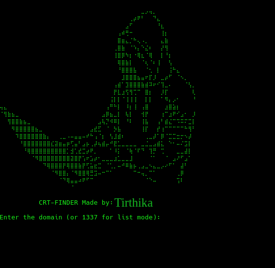

# CRT-FINDER



**CRT-FINDER** is a lightweight Python-based subdomain discovery tool that retrieves publicly available Certificate Transparency (CT) records from [crt.sh](https://crt.sh/).

It helps security researchers discover additional subdomains using certificate records. The tool supports both single-domain searches and bulk domain processing.

---

## Features

- **Certificate Transparency Lookup:** Fetches certificate records directly from crt.sh.
- **Single Domain Mode:** Discover subdomains for an individual domain.
- **Bulk Domain Mode:** Process multiple domains using a TXT file.
- **Automatic Extraction:** Extracts candidate subdomains from certificate records.
- **Duplicate Removal:** Prevents duplicate entries in the output file.
- **Append Support:** Preserves existing results and adds only newly discovered subdomains.
- **Simple Interface:** Easy-to-use interactive terminal interface.

---

## Requirements

Before installing CRT-FINDER, make sure you have:

- Python 3.8 or later
- pip (Python package manager)
- An active internet connection
- Access to crt.sh

### Python Dependencies

| Package | Purpose |
|---|---|
| requests | Sending HTTP requests and retrieving certificate data |
| json | Parsing JSON responses |
| re | Extracting subdomains using regular expressions |
| sys | Handling system operations and exit conditions |

**Note:** `json`, `re`, and `sys` are included in Python's standard library. Only `requests` needs to be installed separately.

---

## Installation

### 1. Clone the Repository

```bash
git clone https://github.com/USERNAME/CRT-FINDER.git
```

Navigate to the project directory:

```bash
cd CRT-FINDER
```

Replace `USERNAME/CRT-FINDER` with your actual GitHub repository URL.

### 2. Create a Virtual Environment (Recommended)

```bash
python3 -m venv venv
```

Activate it:

**Linux / Kali Linux:**

```bash
source venv/bin/activate
```

**Windows:**

```powershell
venv\Scripts\activate
```

### 3. Install Dependencies

```bash
pip install requests
```

Alternatively:

```bash
python3 -m pip install -r requirements.txt
```

If you use the second command, create a `requirements.txt` file containing:

```text
requests
```

---

## Usage

Run CRT-FINDER using:

```bash
python3 crt_finder.py
```

The program displays its banner and asks you to select an operating mode.

### Mode 1: Single Domain Search

Enter the target domain:

```text
Enter the domain (or 1337 for list mode): example.com
```

Provide an output filename:

```text
Enter the output file name: crt.txt
```

CRT-FINDER will:

1. Request certificate records from crt.sh.
2. Extract candidate subdomains.
3. Remove duplicates.
4. Save newly discovered results to the output file.

### Mode 2: Bulk Domain Search

CRT-FINDER also supports processing multiple domains.

Enter:

```text
Enter the domain (or 1337 for list mode): 1337
```

Provide the input TXT file:

```text
Enter path to domain list txt file: domains.txt
```

Provide the output filename:

```text
Enter the output file name: crt.txt
```

### Domain List Format

Create a file named `domains.txt`:

```text
example.com
example.org
example.net
```

Each domain must be on a separate line.

CRT-FINDER processes the domains one by one and collects the discovered subdomains.

---

## Output Example

The output file contains one candidate subdomain per line:

```text
www.example.com
mail.example.com
api.example.com
dev.example.com
```

**Important:** CRT-FINDER appends only new entries. Existing entries in the output file are preserved.

---

## How It Works

CRT-FINDER follows a simple workflow:

1. Accepts a domain or a list of domains from the user.
2. Sends an HTTPS request to crt.sh.
3. Retrieves Certificate Transparency records in JSON format.
4. Parses the certificate data.
5. Extracts candidate hostnames from the `name_value` field.
6. Stores extracted results in a Python set to eliminate duplicates.
7. Checks the existing output file.
8. Appends only newly discovered subdomains.

---

## Ultimate Reconnaissance Workflow

CRT-FINDER can be integrated into a larger subdomain discovery workflow.

### Step 1: Prepare Your Domain List

Create a TXT file containing your authorized target domains.

```text
domains.txt
```

### Step 2: Subfinder

Use Subfinder to discover subdomains:

```bash
subfinder -dL domains.txt -all -recursive -o subdomains.txt
```

### Step 3: CRT-FINDER

Run CRT-FINDER to discover additional subdomains through Certificate Transparency records.

```bash
python3 crt_finder.py
```

Select bulk mode (`1337`) and provide your domain list.

### Step 4: Merge and Remove Duplicates

Combine the results from both tools:

```bash
cat subdomains.txt crt.txt | sort -u > all_subdomains.txt
```

### Step 5: Find Alive Subdomains

Use ProjectDiscovery's httpx to check which discovered hosts respond:

```bash
httpx -l all_subdomains.txt -ports 80,443,8080,8000,8888 -threads 50 -o alive_subdomains.txt
```

### Step 6: Directory Discovery

Use Dirsearch for authorized content discovery:

```bash
python3 dirsearch.py -l alive_subdomains.txt -x 500,502,429,404,400 -R 5 --random-agent -t 50 -F -o directory.txt
```

Adjust concurrency and scanning options according to the target's scope and program rules.

---

## Project Structure

```text
CRT-FINDER/
│
├── crt_finder.py
├── README.md
├── requirements.txt
├── Spicture.png
│
├── domains.txt
├── crt.txt
├── subdomains.txt
└── alive_subdomains.txt
```

The TXT files are input and output examples. They do not all need to exist before running the tool.

---

## Limitations

- Results depend on the availability of crt.sh.
- An internet connection is required.
- Certificate records do not guarantee that a discovered subdomain is currently active.
- The current extraction regular expression supports a limited hostname format and may miss valid hostnames.
- The tool does not perform DNS resolution or HTTP availability checks.
- Results should be reviewed before being used in further reconnaissance.

---

## Troubleshooting

| Problem | Solution |
|---|---|
| `ModuleNotFoundError: requests` | Run `pip install requests` |
| Domain list not found | Check the TXT file path |
| Connection error | Check your internet connection |
| No subdomains found | Verify the domain and check crt.sh |
| Permission denied | Use an output directory with write permission |
| No new subdomains | Previously discovered entries may already exist |

---

## Disclaimer

CRT-FINDER is developed for educational purposes, security research, and authorized reconnaissance.

Users are responsible for ensuring that their activities comply with applicable laws, regulations, and bug bounty program policies.

**Only scan domains and infrastructure that you own or have explicit permission to assess.**

The author is not responsible for any misuse or damage caused by this tool.

---

## Author

**Tirthika
